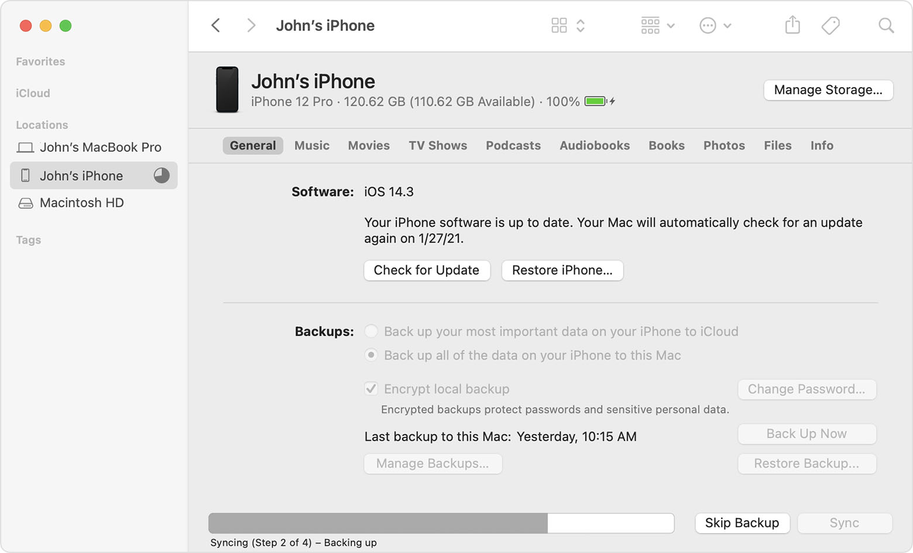
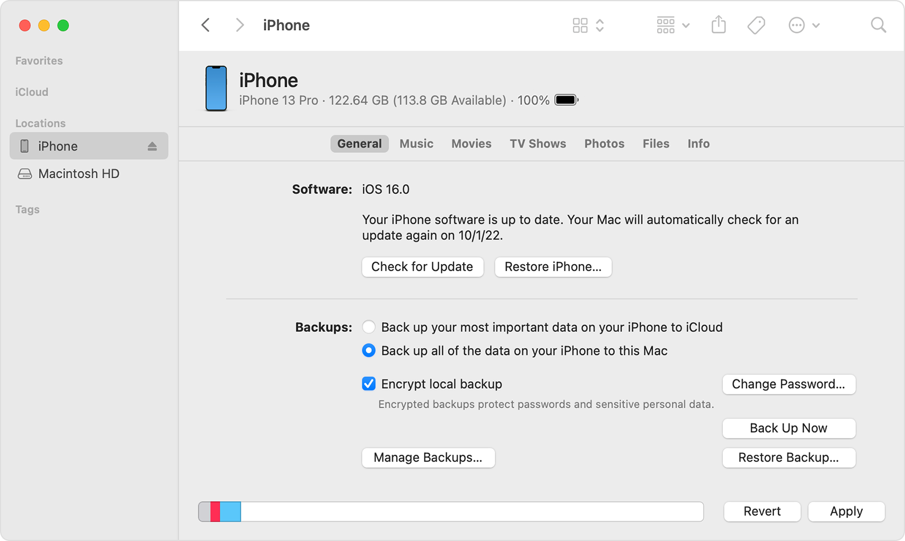
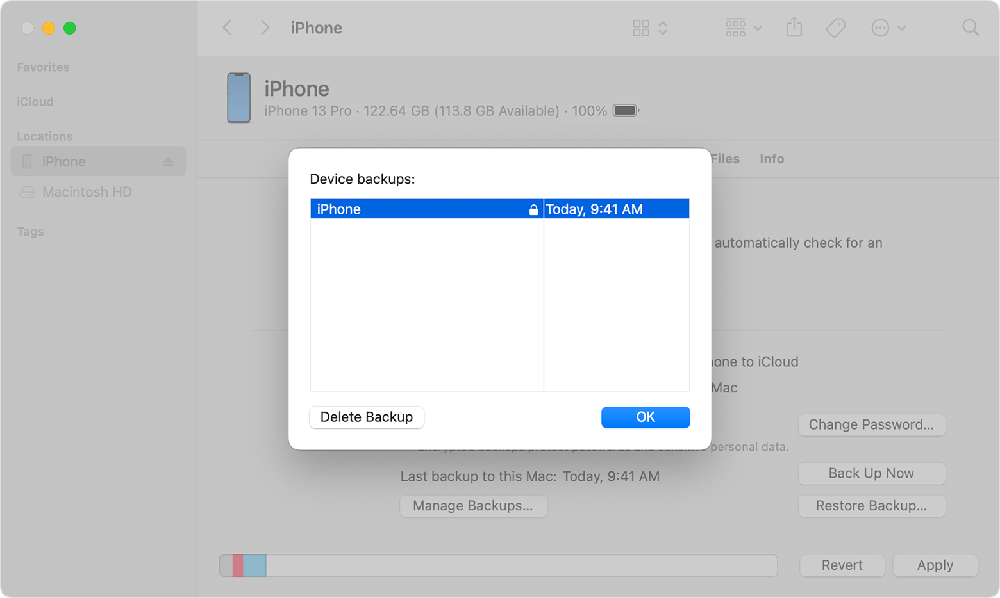

# iTunes ile Yedek Alma

Windows veya macOS bilgisayarlarda iTunes kullanarak iPhone yedeği almak mümkündür (macOS'in daha yeni sürümlerinde bu özellik Finder'a dahil edilmiştir, aşağıya bakın).

Bunu yapmak için:

1. iTunes'in kurulu olduğundan emin olun.
2. iPhone'unuzu bir Lightning/USB kablosu kullanarak bilgisayarınıza bağlayın.
3. Cihazı iTunes'da (veya macOS'te Finder'da) açın.
4. Daha doğru bir tespit elde etmek istiyorsanız, şifreli yedekleme seçeneğinin etkinleştirildiğinden emin olun ve yedek için güvenli bir parola seçin.
5. Yedeklemeyi başlatın ve tamamlanmasını bekleyin (bu 30 dakikaya kadar sürebilir).

_Kaynak: [Apple Support](https://support.apple.com/en-us/HT211229)_

Yedekleme tamamlandıktan sonra konumunu bulun ve MVT tarafından analiz edilebilecek bir yere kopyalayın. Windows'ta yedek, `%USERPROFILE%\Apple\MobileSync\` veya `%USERPROFILE%\AppData\Roaming\Apple Computer\MobileSync\` konumlarında saklanıyor olabilir. macOS'te yedek `~/Library/Application Support/MobileSync/` konumunda saklanır.

# Finder ile Yedek Alma

Daha yeni macOS sürümlerinde bu özellik Finder'a dahil edilmiştir. Yedek almak için:

1. Mac'inizde Finder'ı başlatın.
2. iPhone'unuzu bir Lightning/USB kablosu kullanarak Mac'inize bağlayın.
3. Sol kenar çubuğunun alt kısmındaki "locations" (Konumlar) olarak etiketlenmiş cihaz listesinden cihazınızı seçin.
4. General (Genel) sekmesinde, Backups (Yedekler) bölümü altındaki seçeneklerden `Back up all the data on your iPhone to this Mac` seçeneğini seçin.
5. `Encrypt local backup` yazan onay kutusunu işaretleyin. Bu seçeneği ilk kez seçiyorsanız, yedeği şifrelemek için bir parola girmeniz gerekebilir.

_Kaynak: [Apple Support](https://support.apple.com/en-us/HT211229)_

6. Yedekleme işlemini başlatmak için `Back Up Now` seçeneğine tıklayın.
7. iPhone'unuz için şifreli yedekleme şimdi başlamalıdır. İşlem tamamlandığında `Finder`'ı açıp `General` sekmesine, ardından `Manage Backups` seçeneğine tıklayarak yedeği kontrol edebilirsiniz. Şimdi aşağıdaki görselde olduğu gibi yedeklerinizin bir listesini görüyor olmalısınız:

_Kaynak: [Apple Support](https://support.apple.com/en-us/HT211229)_

Yedeğinizin yanında yukarıdaki görselde olduğu gibi bir kilit varsa, bu yedek şifrelenmiştir. Şifreli yedeğin oluşturulduğu tarih ve saati de görmelisiniz. Yedek dosyaları `~/Library/Application Support/MobileSync/` konumunda saklanır.

## Notlar:

- Oluşturduğunuz yedekleme şifreleme parolasını güvenli bir şekilde saklamayı unutmayın; çünkü o olmadan yedek dosyasına erişemez, değiştiremez veya şifresini çözemezsiniz.
